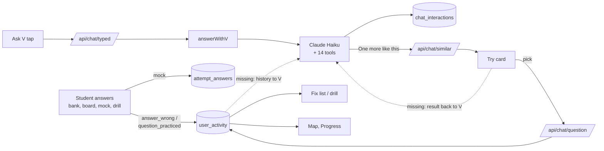

# V as a teacher that follows up: audit and plan (2026-11-10)

What this is: Phase 0 of the learning-loop spec the owner brought in on
2026-11-10 (written with ChatGPT, "PYQVault V: Integrated Learning Engine").
It says what we already have, what is missing, and the order to build the
missing parts. Nothing here is built yet. It sits beside [V_SPEC.md](V_SPEC.md),
which stays V's framework; once a step below is built, its rule moves there.

All numbers were read from production on 2026-11-10. The verified-learning
table comes from `npm run v:learning` (staff left out); the other readings were
hand queries with staff accounts still in (a small overcount).

## 1. The goal in one paragraph

Today V explains a question well and the exchange ends. V never learns
whether the student understood, and it forgets them after an hour. The goal
is a loop: the student tries a question, V explains what went wrong, the
student tries a similar question, and V sees the result and responds. What
the student showed they can do is remembered, so the next conversation
starts from it. Success is measured by learning shown on a NEW question, not
by messages, taps or "I understood".

## 2. The loop, step by step: what exists and what is missing

| Step | What exists | What is missing |
|---|---|---|
| **1. Attempt** | Every answer is recorded: bank and board taps (`question_practiced` with right or wrong, since 2026-10-02), misses (`answer_wrong`), mock answers (`attempt_answers`), drill answers, the V try card | **4 in 5 Ask V taps come before any attempt**: of 534 taps (20 Oct to 8 Nov), only 103 followed a recorded miss |
| **2. Diagnose** | V starts with why the student's pick is wrong (rule 7); checks the student's working when they send it (rule 7b); Review shows why each question is waiting; checked answer sheets carry a `cause` per question (`answer_grades`) | Nothing asks for working when V cannot tell why a pick was wrong; a wrong pick alone rarely says why |
| **3. Teach** | `explain_question` (our solution, never against the key), `explain_concept` (bank model answers, then notes, then the model's own knowledge); "Did you understand? No" gets a re-explanation in smaller steps | The re-explanation only shrinks the steps; it never changes the approach (a prerequisite idea, an example, another way to show it) |
| **4. Practise** | "One more like this" under an explanation (2026-11-08) puts a same-subtopic question in the chat as a try card; the drill; chapter tests; Top 10 PYQs | The tap on "One more like this" is not recorded anywhere |
| **5. Verify** | The try card checks the pick on the server and records it (`question_practiced`, surface `v`); the drill fixes a miss on one right answer | **V never sees the try card's result**, and the answer is not linked to the explanation it followed. Try-card answers so far: 3, all in the week of 19 Oct |
| **6. Remember** | Mistakes stay in the Fix list until answered right (drill); the map (`/me/map`) bands each subtopic with a minimum-evidence rule (`MIN_JUDGED_FOR_CLAIM`); `my_progress` gives V chapter-level results | V's memory is the last 2 exchanges of a session that ends after an hour idle. V cannot see "last time in this subtopic you missed 3 and I explained 1". An explained question the student never answered is remembered nowhere |

Where V can be asked from today: bank questions (`/browse`), board questions,
guide worked examples, notes practice and self-check cards, and the mock
review list. **Not** from: the drill, the Review tab, the map, a mock's result
summary, Home.

## 3. The numbers today (the baseline)

**Verified learning, the north-star count** (`npm run v:learning`, step 1,
staff left out; weeks run Tuesday to Monday, ending on the day it was read).
A student gets question Q wrong (or has it explained), then gets a DIFFERENT
question in the same subtopic right within 7 days. Right answers counted:
bank, board, guide and daily taps, V's try card, the drill, mocks.

| Week | After a graded miss: students verified | needs verified | After an Ask V explanation: students verified | needs verified |
|---|---|---|---|---|
| 13 to 20 Oct | 141 of 247 (57%) | 988 of 2,269 (44%) | (not stored yet) | |
| 20 to 27 Oct | 179 of 322 (56%) | 1,239 of 3,201 (39%) | 30 of 69 (43%) | 49 of 135 (36%) |
| 27 Oct to 3 Nov | 203 of 367 (55%) | 1,435 of 3,275 (44%) | 19 of 74 (26%) | 43 of 136 (32%) |
| 3 to 10 Nov (open) | 152 of 282 (54%) | 857 of 2,106 (41%) | 16 of 54 (30%) | 37 of 100 (37%) |

After a V explanation the rate is LOWER than after a miss. Part of the reason
is the attempt step: most Ask V taps are on questions not yet answered, and many
are written board questions, for which no graded follow-up exists.

Other readings (20 Oct to 8 Nov unless said):
- Ask V taps: 534 from 165 students; 103 after a recorded miss.
- "Did you understand?": 21 Yes, 23 No, on 534 explanations (8% answered).
- The same question missed again within 7 days of its explanation: 18.
- Of 183 students who first used V from 13 Oct to 1 Nov: 38 used V again 1 to
  7 days later, 103 did some learning (any answer, mock or drill) then.
- Subtopics: every PUBLIC question has one (123,264 of 123,264). Concept tags
  cover 42,454 (34%), so "concept" level means **subtopic** here.

**Read the count with care.** A right answer on a new question does not prove
the explanation taught it: the student may have known that question already,
and V users differ from non-users. The readout sets the student's accuracy on
other questions in the subtopic in the 30 days before the week beside the 7
days after their first need. It reads 66-69% before against 66-71% after a
miss, but only for 24 to 59 student-subtopics a week (most students had no
history there), and for 0 to 2 after an Ask V explanation: too thin to judge V
by yet. (Measured from the need instead of the week's start, it read 91%
before and 68% after: the first miss of a week follows only right answers, so
that window was biased and was dropped.)

## 4. What we will not build, and why

- **New tables for attempts, mastery or goals.** `user_activity` is the
  record, and the drill, the map and Progress already fold it. A second copy
  could disagree with it (the reason the drill has no state table).
- **Eight diagnosis categories with a confidence level.** A tapped option
  rarely shows why it was picked; most would come out "not enough evidence".
  Asking for working (step 5 below) gets the evidence instead.
- **A per-user random split for D7 retention.** About 100 to 130 signed-in
  students use V a week. A 20% retention lift would need thousands per arm. The
  loop numbers (section 3) move far more and can be read before and after,
  as every growth experiment here is (`src/lib/growth/registry.ts`).
- **A new feature-flag system.** V's switches already live in `chat_settings`
  (`/dashboard/chat`): each step below gets one, and switching it off is the
  rollback.

## 5. The plan, in build order

Each step is small, ships alone, has its own switch where students see it,
and stops for the owner's OK. "S" is a day or less, "M" two to three days.

### Step 1. The weekly count (S, read-only, no migration): BUILT 2026-11-10

`npm run v:learning`: the table in section 3 every week, staff removed, with
the stage numbers (explanations, try cards opened, answered, right) and the
before-miss accuracy beside each loop. Its definitions go into V_SPEC.md and
it joins the Thursday review (section 7 there), next to the follow-up line.
Pure core plus tests first (TDD), like `v:followups`.

### Step 2. V sees the follow-up answer (M; one small migration)

The missing link in the loop.
- Record the "One more like this" tap (today nothing is written).
- The try card's answer carries which explanation it followed
  (`metadata.after_explained`), so a verified loop can be counted exactly,
  not guessed from time and subtopic.
- After the pick, V responds in the chat:
  - **Right:** a fixed line, no AI call ("Right: you used the same idea on a
    new question."), and "One more like this" again.
  - **Wrong:** "Show me where I went wrong" opens an explanation that is told
    it follows the first one, so it compares the two questions instead of
    starting over.
- Eval cases: a wrong follow-up, a right follow-up, a follow-up after a No.

### Step 3. V remembers the student's subtopic (M, no migration)

On an Ask V tap, V is told, in one line built by code (no tool call, no extra
AI cost): this student's recent misses in this subtopic, what V explained
there before, and how the next question went. Read from `user_activity` and
`chat_interactions` with the student's own login. V can then say "last time
the sign of g tripped you" instead of starting cold. Rule 12 gets one line
on how to use it. Eval cases: a returning student, a student with no history.

### Step 4. Teach differently on a No, and ask for working (S, prompt only)

- A No changes the approach: a prerequisite idea first, a worked example,
  or another way to show it, not only smaller steps.
- When V cannot tell why a pick was wrong, it says so and shows a "Send my
  working" button (rule 7b already checks working).
- Eval cases from the 23 real No's.

### Step 5. V in more places (M, one surface at a time)

An Ask V entry, each passing its context so the student never has to explain
where they are:
- a drill miss ("Why was this wrong?");
- the Review tab's waiting questions;
- a weak subtopic on the map ("Help me with this subtopic");
- a mock's result summary ("Where did I lose marks?", built on `my_progress`
  and the mock report).

### Step 6. Decisions for the owner before they are built

1. **Try first.** 4 in 5 Ask V taps come before an attempt. Should V, on a
   question not yet answered, offer "Try it first" beside the explanation?
   (Today V explains straight away, owner 2026-10-20.)
2. **V speaking after a follow-up** (step 2) is V adding something unasked,
   which rule "answer only what was asked" (2026-10-22) forbids in its text.
   The step uses fixed lines and buttons, not V's text; is that within the rule?
3. **Explained questions in the Fix list.** Should a question V explained but
   the student never answered join the Fix list until answered right?
4. **One check-back later.** The drill fixes a miss on one right answer, same
   day included (owner 2026-10-05: a queue that only grows demotivates).
   Should a fix be checked once more a few days later, to show it lasted?
5. **Free answers.** A try-card answer uses one of the day's free answers.
   Should a follow-up right after an explanation be free?
6. **Order.** Steps 1 to 4 apply to every exam. Step 5's surfaces could start
   with the exams where Ask V is used most. Agree, or a different start?

## 6. Risks and how each is handled

| Risk | Handling |
|---|---|
| The count credits V for what the student already knew | The before-miss accuracy beside each loop (step 1); read as a trend, never one week |
| V users are keener students | Compare a student with their own earlier weeks, not with non-users |
| `answer_correct` is written only after an earlier miss, so first-time right answers live in `question_practiced` and `attempt_answers` | The readout reads all three, as the baseline query did |
| V explanations are attributable only since 2026-10-20 (`asked_question_id`, migration 0174) | The baseline starts there |
| A bank miss is recorded once per question per day | Fine for a weekly count |
| Notes practice answers may not be recorded at all | Check in step 1 before counting notes |
| Fix Points pays for fixed mistakes (experiment until about 9 Dec) | Nothing here changes what pays; a verified follow-up is not a new reward |
| More context makes V's answers dearer | Step 3's line is built by code and small; `npm run v:cost` is read after each step |
| A failed read breaks V | Every new read fails alone: V answers as today without it |

## 7. Testing and rollout

- TDD for every pure core (the count, the history line, the follow-up link).
- `v:eval`: new cases per step, then the whole set once before merging
  (V_SPEC.md section 5); no case that passed may fail without a reason.
- Each step that students see: a `chat_settings` switch, a growth-registry
  entry with its bar and read date, and a before/after screen sheet.
- Rollback: switch off. No step deletes or rewrites existing records.
